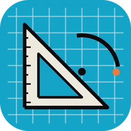

  
ARTCRAFT / KNOWLEDGE BASE

  <h1 id="_top">Make something <em>worth sharing.</em></h1>
  
Find your way around ArtCraft and the Craft Apps. Choose an app to explore its guides, workflows, and support resources.

  

THE CRAFT APPS
<h2>Find your app</h2>
17 APPS

  

    <section className="app-category">
      

        <h3>AI and generative media</h3>
        1 APP
      

      

        <a className="app-tile" href="/apps/artcraft-studio/overview/">
          

            
          

          

            <strong>ArtCraft Studio ↗</strong>
            Generative images &amp; video
          

        </a>
      

    </section>

    <section className="app-category">
      

        <h3>Graphics and design</h3>
        7 APPS
      

      

        <a className="app-tile" href="/apps/photocraft/overview/">
          

            
          

          

            <strong>PhotoCraft ↗</strong>
            Image editor
          

        </a>
        <a className="app-tile" href="/apps/vectorcraft/overview/">
          

            
          

          

            <strong>VectorCraft ↗</strong>
            Vector illustration
          

        </a>
        <a className="app-tile" href="/apps/lightcraft/overview/">
          

            
          

          

            <strong>LightCraft ↗</strong>
            Photo library &amp; raw developer
          

        </a>
        <a className="app-tile" href="/apps/designcraft/overview/">
          

            
          

          

            <strong>DesignCraft ↗</strong>
            Page layout &amp; publishing
          

        </a>
        <a className="app-tile" href="/apps/figcraft/overview/">
          

            
          

          

            <strong>FigCraft ↗</strong>
            Interface design
          

        </a>
        <a className="app-tile" href="/apps/texturecraft/overview/">
          

            
          

          

            <strong>TextureCraft ↗</strong>
            3D texture painting
          

        </a>
        <a className="app-tile" href="/apps/materialcraft/overview/">
          

            
          

          

            <strong>MaterialCraft ↗</strong>
            Procedural materials
          

        </a>
      

    </section>

    <section className="app-category">
      

        <h3>Video and effects</h3>
        2 APPS
      

      

        <a className="app-tile" href="/apps/filmcraft/overview/">
          

            
          

          

            <strong>FilmCraft ↗</strong>
            Video editor
          

        </a>
        <a className="app-tile" href="/apps/effectcraft/overview/">
          

            
          

          

            <strong>EffectCraft ↗</strong>
            Motion graphics &amp; VFX
          

        </a>
      

    </section>

    <section className="app-category">
      

        <h3>Audio</h3>
        1 APP
      

      

        <a className="app-tile" href="/apps/soundcraft/overview/">
          

            
          

          

            <strong>SoundCraft ↗</strong>
            Digital audio workstation
          

        </a>
      

    </section>

    <section className="app-category">
      

        <h3>CAD and drafting</h3>
        1 APP
      

      

        <a className="app-tile" href="/apps/cadcraft/overview/">
          

            
          

          

            <strong>CADCraft ↗</strong>
            Computer-aided design &amp; drafting
          

        </a>
      

    </section>

    <section className="app-category">
      

        <h3>Office</h3>
        4 APPS
      

      

        <a className="app-tile" href="/apps/wordcraft/overview/">
          

            
          

          

            <strong>WordCraft ↗</strong>
            Word processing
          

        </a>
        <a className="app-tile" href="/apps/gridcraft/overview/">
          

            
          

          

            <strong>GridCraft ↗</strong>
            Spreadsheets &amp; data analysis
          

        </a>
        <a className="app-tile" href="/apps/deckcraft/overview/">
          

            
          

          

            <strong>DeckCraft ↗</strong>
            Presentations &amp; slide shows
          

        </a>
        <a className="app-tile" href="/apps/pdfcraft/overview/">
          

            
          

          

            <strong>PdfCraft ↗</strong>
            PDF workbench
          

        </a>
      

    </section>

    <section className="app-category">
      

        <h3>Developer tools</h3>
        1 APP
      

      

        <a className="app-tile" href="/apps/craft-anything/overview/">
          

            
          

          

            <strong>Craft Anything ↗</strong>
            Software exploration &amp; creation
          

        </a>
      

    </section>
  

  

    

      
COMMUNITY &amp; ECOSYSTEM

      <h2>Third-Party Apps</h2>
    

    1 APP
  

  
Third-party and community applications built for the Craft ecosystem. These apps are independently maintained by their respective creators.

  

    <a className="app-tile" href="/apps/solidcraft/overview/">
      

        
        Third party
      

      

        <strong>SolidCraft ↗</strong>
        Independent parametric 3D CAD
      

    </a>
  

